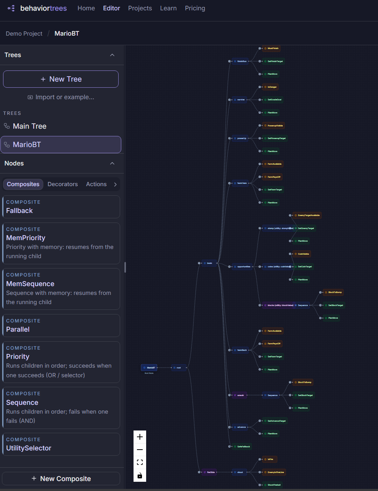

# project 3 - behavior tree mario

**i want to join the competition.** 

(agent folder is `src/agents/firstLast/`, everything for the agent lives in there)

## where the code is

everything i added is under `src/agents/firstLast/`. the only other change is `src/PlayLevel.java` (runs my agent on original level 10, 20 secs, small mario, visuals on)

here's an overview to recap for me and give you context:

- `Agent.java` - my MarioAgent. it loads the tree from `mario_bt.xml` when the game starts, then every frame: update perception -> tick the tree once -> press whatever the tree picked.
- `mario_bt.xml` - **the behavior tree itself as a text file.** since it's interpreted as the assignment asked, changing this changes the agent.
- `bt/` - the bt engine. `Task`, `Status` (success / failure / running), `Blackboard`, composites `Sequence`, `Selector`, `Parallel`, `UtilitySelector`, decorators `Inverter`, `Succeeder`, `Repeat`, `UntilFail`, `Cooldown`, leaf bases `Condition` / `Action`, and `BTLoader` which is the xml interpreter.
- `tasks/` - the mario conditions and actions (one class each) plus `MarioTasks` which maps xml names to classes.
- `mario/` - perception (`WorldModel`, `Scout`), the look ahead `Planner`, farming logic (`Farm`), a tiny floor graph search (`Nav`), and the `Goal` the tree hands to the planner.

## the bt engine and the interpreter

every node extends `Task` and has `run(blackboard)` that does one cycle and returns success, failure, or running (this is how it was covered in class). the interpreter uses java's built in dom parser to read the xml and then walks it recursively -> every tag turns into an object: `<sequence>`, `<selector>`, `<parallel>`, `<utilityselector>`, decorator tags, and leaves `<condition>CoinVisible</condition>`. extra attributes are knobs for the leaf (ex `<condition speed="8" margin="30">MustFinish</condition>`), so the same condition class gets reused with different numbers. i made sure unknown tags or names throw a clear error when the game starts.

**no while loops in the composites.** each tick a composite gives each child node (cn) at most one cycle (a for loop over the cn list that returns as soon as a cn says running or the result is decided). a sequence remembers the index of a running cn and picks it up next tick. selectors start from the top every tick so a higher priority branch can cut in, and when that happens the old running branch gets reset.

## the tree



52 tasks total X_X, but it wasn't as bad since a lot of the same nodes are reused once it was built out. to incorporate fire form the root is a parallel to decouple movement from it: the movement brain and a side branch that throws fireballs (wrapped it in a succeeder so it can never break movement). the brain is a priority selector since movement is more important:

1. **finishRun** - if frames left <= distance to flag / rush speed + margin, go touch the flag. this is on top becuase i'm assuming mario has to finish to make the run count for the competition, "based on the points collected" wasn't too clear on that.
2. **survive** - an enemy is right next to mario and closing, stomp it or back off.
3. **powerUp** - a mushroom or flower is out, grab it before it rolls into a pit.
4. **farmHere** - standing at a good respawn spot and the clock still has room, farm it (see below).
5. **opportunities** - i made a utility selector (btw based it on the decision theory slide) between stomping an enemy, grabbing a coin, and bonking a block. each one scores value / (1 + travel frames / 25), best gets tried first, the last winner gets a small bonus so it doesnt flip flop.
6. **farmBack** - nothing near, walk back to a good farm spot if there is time.
7. **smash** - big mario with nothing else to do breaks bricks (behind a cooldown) becuase smashing stuff is fun, why not lol.
8. **advance** - move right but park short of the flag, finishing early ends the run.
9. **SafeFallback** - no target, just the safest thing.

the condition / Set Target leaves pick *what* to do and write a goal to the blackboard. the `PlanMove` action then works that out *how*: it simulates button combos with the forward model (beam search, combos held for 2 frames, 24 frames ahead) and scores each plan with a utility function (coins, kills, power ups, progress toward the goal, a hit is a big minus, death throws the plan away). that is the "utility function + list of actions + simulate the effect" recipe from the decision theory slides too, put inside a bt leaf. `PlanMove` fails if no plan is safe or if it stopped making progress on a target, then the target goes on a blacklist and the selector moves on, which is a nice bt pattern if i do say so (its mine so ofc its nice lol)!

**Note:** i found that enemy spawning is very simplistic and tried to take advantage of that, that is how i plan to win mwuahahahaha >:3

**farming.** the engine respawns an enemy when its spawn tile scrolls back into the camera window and the old one is gone (also get this, i found enemies that fall in a pit on screen count as kills) so the agent remembers where enemies spawn and how long they lived, and for spots that keep giving kills it stands right at the camera edge and steps out and back in. `FarmPaysOff` only allows another round if the frames left still cover: walking there + one round + coins we know are still ahead + the part of the level we never saw + the run to the flag. just lmk if this is getting too evil, idk if this is like npc abuse but its gonna help me win i hope

## what was easy and what was hard with bts
so...
- **easy:** priorities and reacting. "finish if the clock is low, else survive, else power up, else the best opportunity" is just using selector, and reordering behavior is editing xml. blacklisting a failed target and letting the selector try the next thing also came together naturally.
- **hard: precise platforming.** level 10 is mostly tiny platforms over pits. no amount of `IsGapAhead -> Jump` conditions gets jump timing right, so the leaf had to simulate. the bt decides the goal, the planner does the jump physics.
- **hard: state machine stuff.** the farm loop (wait for the enemy, step out, step back in) is really a little fsm. in a bt it turned into one action reading loop state off the blackboard, very clunky!
- **hard: scheduling.** coins vs farming vs the deadline is a budgeting problem across the whole run. a bt only looks at right now, so i had to fake look ahead with time estimates in a condition, and tune them (this took a too much repitition).
- **bugs that taught me stuff:** a receding horizon planner "procrastinated" (the plan "wait one frame then go" always tied with "go now" and won, so mario never moved), fixed by paying progress when it happens instead of only at the end. a coin two jumps up was out of the planners reach, fixed with a small breadth first search over remembered floor tiles that hands the planner a stepping stone.

## results on level 10 (20 secs, small mario)

```
Game Status: WIN Percentage Completion: 1.0
Lives: 0 Coins: 23 Remaining Time: 2
Mario State: 1 (Mushrooms: 10 Fire Flowers: 0)
Total Kills: 13 (Stomps: 12 Fireballs: 0 Shells: 0 Falls: 1)
Bricks: 0 Jumps: 30 Max X Jump: 204.43756 Max Air Time: 44
```

that is -> all 23 coins in the level, 13 kills, never got hit, and it touches the flag with about 2 seconds left, whew i know its awesome! the time knobs in the xml (rush speed, safety margin, farm costs) were tuned by running the level with different values, the logic itself has no level 10 positions in it. on other original levels it wins 1, 3, 5, 6, 8 and 11 (level 1 grabs the fire flower and gets 8 fireball kills), but it still gets stuck and times out on 2 and 4, so it fails sometimes.

every sample agent that comes with the framework dies on level 10 within the first 4 seconds (robinBaumgarten gets to 53%). the run is fully deterministic so it gives the same result every time.

side note: the engine adds the events of a power up frame again on every frame of the 9 frame power up pause, so "Mushrooms" prints as 10 after one mushroom (and any kill landing on that exact frame would be counted 10 times). i did not try to exploit that.

thank you for reading and grading TA~! you are probably looking at a lot of projects, but this one is special to me